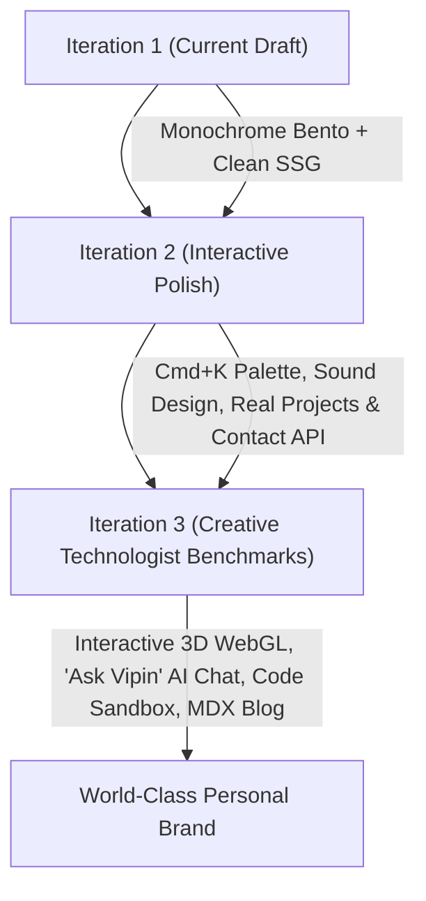

# 🚀 Personalized Portfolio Action Plan & Iteration Roadmap

> **Target:** Vipin Kaushik — Full-Stack Developer & Creative Technologist  
> **Repository:** [https://github.com/vpn-cli/portfolio](https://github.com/vpn-cli/portfolio)  
> **Framework:** Next.js 15 (App Router, React 19) + TypeScript + Tailwind CSS  
> **Aesthetic Standard:** Modern Bento Grid, Swiss Typography, Tactile Micro-Interactions, True Monochrome Palette  

---

## 🎯 Executive Summary

The initial draft of the portfolio has established a solid architectural foundation:
- Single-viewport 10-module Bento Grid density (1440px desktop calibrated)
- Quiet monochrome palette (`#09090B` canvas, `#141519` tiles, `rgba(255,255,255,0.08)` borders)
- SSG static prerendering on Next.js 15 App Router across all 9 routes
- App-store styled squircle tech stack badges, live status indicator, and clipboard copy state machine
- Full Git tracking on GitHub (`https://github.com/vpn-cli/portfolio`)

This document lays out the **Personalization Action Plan** (transitioning from design template to Vipin Kaushik's authentic professional showcase) and the **Iterations 2 & 3 Enhancement Roadmap** for cutting-edge creative technologist features.

---

## 📋 Section 1: In-Depth Personalization Action Plan (Iteration 1.5)

To make this portfolio 100% authentically yours, execute the following four focus areas:

### 1. Authentic Identity & Personal Branding
| Component / File | Current Placeholder State | Required Personalized Value |
| :--- | :--- | :--- |
| **Portrait Avatar** (`public/avatar.jpg`) | Synthetic vector illustration | High-resolution editorial or outdoor photograph of Vipin Kaushik (can use cropped `public/images/moi.jpeg` or studio headshot). |
| **Hero Bio** (`content/site.ts`) | Generic full-stack description | *"Engineering high-concurrency cloud systems, distributed architectures, and tactile user interfaces that feel physically alive."* |
| **Social Links** (`content/site.ts`) | Generic handles (`@vipin_dev`, `@vipin`) | Verified personal handles:  • **GitHub:** `https://github.com/vpn-cli`  • **LinkedIn:** `https://www.linkedin.com/in/vpnk2003`  • **X / Twitter:** `https://x.com/your-handle`  • **Email:** `vipinkaushik20771041@gmail.com` |
| **Location & Timezone** (`content/site.ts`) | Configured | `New Delhi, India` (`Asia/Kolkata`, UTC+5:30) with real-time digital clock display. |
| **Curriculum Vitae / Resume** | None | Add a downloadable `public/resume.pdf` with a quick link button in the navigation header and About page. |

---

### 2. Showcase Vipin's Real Engineering Projects
Replace the template case studies (`cashless`, `mono`, `nexus`) with your actual flagship software:

#### Project 1: **AppForge — Generative AI Prompt-to-Software Platform**
- **Repository:** `github.com/vpn-cli/appforge`
- **Tagline:** A generative AI platform allowing users to dynamically design, build, and configure custom applications in real time using natural language.
- **Role:** Creator & Lead Architect
- **Deliverables:** Next.js Full-Stack Architecture, LLM Orchestration Engine, Dynamic UI Code Compiler, Real-Time Streaming Sandboxes.
- **Key Metrics:** Sub-100ms first token streaming latency, zero-setup browser runtime compilation.
- **Visuals:** High-resolution screenshot of the AppForge workspace, code-generation canvas, and component tree preview.

#### Project 2: **Graph Engine & Interactive Visual Data Systems**
- **Repository:** `github.com/vpn-cli/graph`
- **Tagline:** High-performance graph traversal algorithms and interactive topological data visualization.
- **Role:** Systems & Frontend Engineer
- **Deliverables:** WebGL / Canvas rendering pipeline, WebSocket telemetry, custom graph query parser.
- **Key Metrics:** 60 FPS smooth rendering for 10,000+ nodes, sub-second graph query execution.

#### Project 3: **Distributed SQL Practice & High-Concurrency Backend**
- **Repository:** `github.com/vpn-cli/sql-practice` / Microservices
- **Tagline:** Interactive database playground and query execution benchmarking tool.
- **Role:** Backend Infrastructure Engineer
- **Deliverables:** Sandboxed SQL execution containers, query execution plan visualizer, rate limiter.

---

### 3. Real Interactive Backend Integrations
1. **Functional Contact Form / API Route:**
   - Create `app/api/contact/route.ts` using [Resend](https://resend.com) or [Formspree].
   - When a client fills the "Have a project in mind?" box or clicks send, deliver the email directly to `vipinkaushik20771041@gmail.com` with spam protection.
2. **Real Newsletter Subscription:**
   - Connect the newsletter tile to Supabase, Beehiiv, or Buttondown API for genuine subscriber capture.
3. **Live GitHub Activity Feed:**
   - Fetch real-time commit activity and star counts from the GitHub API for `@vpn-cli` and display a discreet "Latest push: X hours ago" badge on the GitHub social squircle.

---

## ⚡ Section 2: Iterations 2 & 3 Future Enhancements

These high-impact elements can be introduced over the next 1–2 iterations to elevate the portfolio from a standard portfolio into an award-winning creative technologist benchmark.

---

### 🌟 Iteration 2 Enhancements (Tactile Polish & Utility)

#### 1. Global Command Palette (`Cmd+K` / `Ctrl+K`)
- **Technology:** `cmdk` (Radix UI)
- **Feature:** Pressing `Cmd+K` or clicking a compact search pill opens a floating glass modal.
- **Actions:**
  - Fast navigate to `/`, `/about`, `/resources`, or any project case study.
  - One-click copy email / copy phone.
  - Download Resume PDF.
  - Toggle theme (Charcoal / Titanium / Sepia).
  - Open external GitHub (`@vpn-cli`) or LinkedIn in new tab.

#### 2. Tactile Sound Design (Web Audio API)
- **Feature:** Subtle, high-end mechanical click, toggle, and spring sounds on interactive actions:
  - Button hover: ultra-soft acoustic tick (12ms at 4kHz).
  - Copy email: satisfying haptic latch settle.
  - Theme toggle switch: authentic analog toggle switch snap.
  - Include an audible Mute/Unmute audio toggle pill in the corner.

#### 3. Live Terminal / Micro-Playground Tile
- **Feature:** Replace one of the decorative corners with a live interactive CLI card:
  - Users can type `help`, `bio`, `stack`, `contact`, or `cat resume.txt`.
  - Type `npx vpn-cli` to receive a colored ANSI developer card output.

#### 4. Case Study Interactive Architecture Explorer
- **Feature:** Inside `/work/[slug]`, provide an interactive system architecture diagram built with React Flow or SVG Zoom:
  - Click on components (Client -> Edge Proxy -> Next.js API -> Redis -> PostgreSQL) to inspect latency budgets, failure recovery, and tech stack details.

---

### 🚀 Iteration 3 Enhancements (Advanced Creative Engineering)

#### 5. Real-Time 3D WebGL Monolith (Three.js / React Three Fiber)
- **Feature:** Optical glass prism or 3D device mockup that refracts the background with real-time caustics, chromatic aberration, and gyroscope tilt.
- **Optimization:** Automatic `IntersectionObserver` pause so off-screen rendering uses 0% GPU.

#### 6. "Ask Vipin" AI Agent Assistant (Gemini API / Function Calling)
- **Feature:** A discrete floating drawer or bento card powered by the Gemini 2.5/3.8 Flash API.
- **Capabilities:**
  - Trained specifically on Vipin Kaushik's resume, work experience, GitHub repositories, and design philosophy.
  - Can answer recruiter questions like:
    - *"What experience does Vipin have with distributed systems?"*
    - *"Is Vipin available for contract work or full-time roles?"*
    - *"Show me Vipin's projects built with Next.js and TypeScript."*

#### 7. MDX Technical Engineering Blog
- **Feature:** Route `/blog` and `/blog/[slug]` with syntax-highlighted code blocks, copy-to-clipboard buttons, reading time estimates, and interactive React component embeds.

#### 8. Progressive Web App (PWA) & Offline Capability
- **Feature:** Service worker caching for sub-10ms instant page loads and offline reading on mobile devices, with a custom installable app icon for iOS and Android.

---

## 🛠 Recommended 5-Step Action Plan to Execute Next

1. **Step 1:** Add Vipin's real headshot photo to `public/avatar.jpg` and updated bio text in `content/site.ts`.
2. **Step 2:** Swap `cashless`, `mono`, and `nexus` in `content/site.ts` with **AppForge**, **Graph**, and your backend architectures with real GitHub repo links.
3. **Step 3:** Place `resume.pdf` into `public/` and wire up the Resume download button.
4. **Step 4:** Implement `app/api/contact/route.ts` using Resend for working contact submission.
5. **Step 5:** Deploy to [Vercel](https://vercel.com) with custom domain connection (`vipinkaushik.dev` or similar) and automated GitHub push CI/CD.
